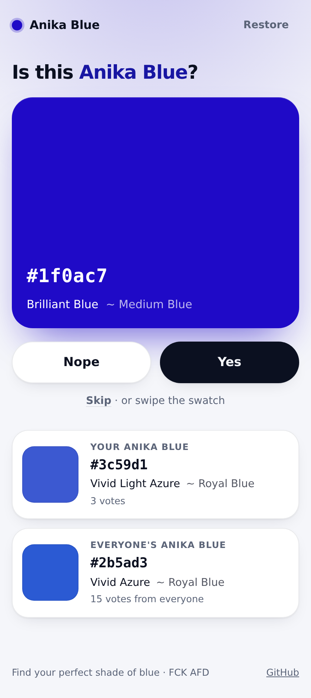

<p align="center">
  
</p>

<p align="center">
  <a href="https://nixbot.brkn.lol/repos/github/pschmitt/anika-blue"></a>
</p>

<h1 align="center">Anika Blue</h1>

<p align="center">
  Find your perfect shade of blue, one swatch at a time. FCK AFD.
</p>

<p align="center">
  <picture>
    <source media="(prefers-color-scheme: dark)" srcset="assets/screenshot-dark.png">
    
  </picture>
</p>

## Features

- **Swipe or tap to vote** on random shades of blue: Yes, Nope or Skip, with
  swipe gestures on touch screens and arrow keys (or `Y`, `N`, `S`) on desktop.
- **Your Anika Blue**, the average of every shade you said yes to, next to
  **everyone's Anika Blue**, the average of all yes votes.
- **Color names** for every shade: a description such as "Vivid Dark Azure" and
  the nearest CSS named color. Click a hex code or name to copy it.
- **No accounts**: a signed session cookie identifies you. Your Anika Blue
  doubles as a key that restores your session on another device.
- **One small binary**: Rust (axum, SQLite), with the templates, CSS and
  JavaScript built in. No build step, no web fonts, no JavaScript framework.
- **Light and dark** themes that follow the system setting, on a neutral
  background so the shades look as they are.

## Install

With Docker:

```sh
docker run -p 5000:5000 -v anika-blue:/data -e SECRET_KEY=change-me ghcr.io/pschmitt/anika-blue
```

On NixOS, import the flake's `nixosModules.default` and set
`services.anika-blue.enable = true`. See [docs/deployment.md](docs/deployment.md)
for the module options, Docker Compose and the configuration.

## Quick start

```sh
nix run github:pschmitt/anika-blue              # or: cargo run
xdg-open http://127.0.0.1:5000                  # vote on a few shades
anika-blue --help                               # listen address, database, secret
```

Set `SECRET_KEY` (or `SECRET_KEY_FILE`) in production; without it, sessions
reset whenever the server restarts.

## Documentation

| Topic | |
|---|---|
| [Deployment](docs/deployment.md) | Docker, Docker Compose, the NixOS module and configuration |
| [Development](docs/development.md) | Dev shell, tests, linting, CI and screenshots |

## License

GPL-3.0-only. See [LICENSE](LICENSE).
